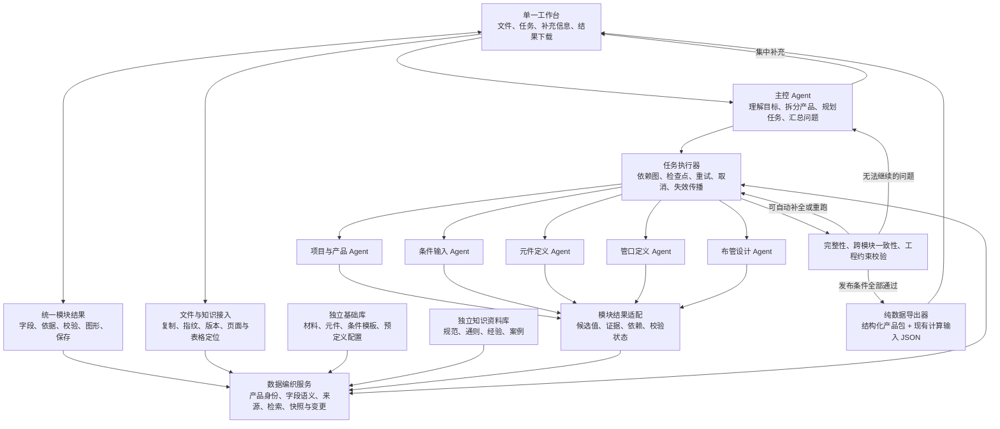

# 独立层级 Agent 平台架构与实施方案

日期：2026-11-13。状态：目标架构设计；独立库、后台副本、任务/数据空间与抽取原型已实现，完整产品生成链尚未完成。实际进度见 implementation-status.md。

最新范围修正：自动处理输入中识别出的全部产品，不设置BKU或首台限制。各产品按自身类型、型式和来源取得模板与任务上下文；缺少适配器时保留该产品，不替换为其它型式。下文BKU仅作为历史首次测试样本。

缺项先进入审核循环：来源复查、适用默认值与字段规则；可缺省项及必需性尚未确定的项延后复核。只有契约明确必需且自动审核后仍缺失、冲突或非法的字段进入人工队列。人工提交必须校验并重新进入循环；缺项不阻止独立步骤及其它产品继续。功能尚未接入属于能力说明，不属于用户缺参数。

2026-11-15 最新界面要求：原模块的功能合并到统一UI，取消原应用工作台入口。聊天式主界面承担任务输入、消息回执与历史；统一模块面板承担结构化结果、字段依据、编辑校验和几何操作。后台保留模块服务的隔离，避免同名 `config`、`app`、`core` 冲突；向用户呈现共同的编辑器外壳和管束四阶段功能部件。保存经过产品/来源/版本检查并送回审核循环。数据空间显式展示文件、知识、字段、基础配置和版本化审核快照；运行图来自实际调用回执与计时，不能用目标架构图冒充已发生的执行。

## 1. 本期交付边界

目标用户动作：在聊天中提交项目输入文件与知识资料，说明产品生成目标；从模块结果查看、编辑与校验，在数据空间核对来源与共享关系，在运行记录查看实际调用图和用时。平台最终应输出按产品隔离的完整计算前数据包和计算输入 JSON，目前完整工程规则与纯计算导出尚未完成。

已确认采用独立数据库副本。原系统仅作为初始化数据和兼容性核对来源，不作为平台运行时依赖。新平台产品身份、任务状态、产品实例、文件和知识引用均独立管理，不跟随原软件当前产品。

本期不执行强度计算、生成报告或图纸；不把已有 `.dlpec` 数据库快照格式冒充新产品包。新包采用版本化 ZIP + JSON。若以后需要 `.dlpec`，另做显式兼容适配器。

布管几何有别于强度计算。计算前可能已需要坐标、实际管数、管板尺寸及轴向参数。用户已确认复制 `HE3DTB.dll` 作为平台后台几何引擎；不能因不做强度计算就省掉必要几何结果。

用户允许按复制的预定义配置、规范和确定规则形成预设计值并保留依据，后续由计算校核。采用库内“默认”配置，由本次文件和规范覆盖明确要求，不能套用原来启用的其它项目专属配置。

## 2. 总体结构



主控 Agent 负责规划和沟通；确定性执行器落实依赖、版本、失败处理。LLM 不直接执行任意 SQL、不直接修改文件或宣布工程数据完整。结构化结果经契约和领域规则校验后，由数据服务接受。

数据编织不等于文件转发。它将库表、模板、文档片段与产品实例统一为可查找的数据对象，保留原始来源和版本，以字段依赖关系向子 Agent 提供正确范围的数据，并追踪其产出的影响。

## 3. 独立部署与数据隔离

建议部署：一个独立桌面工作台、一套平台服务、一个私有 MySQL 实例、一个独立数据空间目录。先保持现有 SQL、字段类型和模板语义，避免在拆分 Agent 同时引入数据库引擎迁移。

本机开发可使用独立进程与数据目录。端口必须显式配置且与原库区分，不能只修改库名仍让进程连接原实例。具体端口不预先写死。

### 初始化复制

1. 建立原库只读导出配置与新实例配置，验证地址、端口和实例身份不相同。
2. 盘点实际依赖。候选基础库为材料库、元件库、产品定义库、产品条件库、配置库；这是初始范围，须按查询调用链补齐，不宣称已经覆盖全部依赖。
3. 对基础库复制结构与数据；对产品需求、项目需求和产品设计活动库，默认仅建立必要结构，不自动复制原有项目实例和历史产品。
4. 记录表结构摘要、行数、导出文件字节数和 SHA256，以及一致性方式。跨连接、非事务表或不同来源不宣称原子快照。
5. 在新实例导入并核对模板、材料关系、元件关联、预定义配置和外部资源路径。保留迁移回执。
6. 知识资料复制为平台托管文件；目录元数据及实际文件必须一起迁移。原位引用和远程资源不能仅复制路径便标为脱离原系统。
7. 清除源实例凭据。正常运行仅允许显式配置的新实例。目标实例离线时失败并提示，不回退原库。
8. 做断源验收：没有原库连接能力、没有原程序进程时完成同一输入案例。

### 数据空间复用

复用 `data_center_standalone/data_center` 的资源登记、知识包、字段来源、版本和产品范围等后台能力。界面可以嵌入其必要浏览组件，不能要求打开第二个业务窗口完成流程。

每次平台启动显式指定自己的数据目录、数据库配置和产品上下文。不能沿用原 `%LOCALAPPDATA%/DongLanpec/data_center` 或当前产品通知文件作为默认数据源。

资源目录备份不含源数据库和原位文件。迁移须使用现有托管文件校验能力，并补齐原位资料托管化；知识摘录包仅是有界上下文，不能替代完整知识库备份。

## 4. 数据编织服务的契约

统一身份：`workspace_id / project_id / product_id / object_id / field_id`。原库 ID 保留为 `source_identity`，不能与平台新 ID 混用。位号用于匹配候选，不单独作为全局身份；同名元件、壳程/管程、工况、Tab_ID、合并实例必须明确区分。

每个字段包含：值、单位、适用性、状态、来源类别、证据引用、来源版本、规则版本和依赖字段。数值零、未找到、未提供、未知、不适用、模板默认值分别保存；不把缺失统一转为 `0`、空串或 `—`。

数据服务提供的逻辑操作：

- `ingest_sources`：受控复制输入文件，记录哈希和版本，提取内容位置。
- `create_product_scope`：按项目与产品隔离文档页段、实例和知识引用。
- `resolve_requirements`：读取该产品型式、预定义配置、模块和工况的模板及必填要求。
- `retrieve_context`：按产品引用、模块需求、关键词/语义和来源权限构造有界知识上下文；输出覆盖范围及截断提示。
- `build_task_envelope`：冻结输入字段、文件和知识的版本，生成任务输入指纹。
- `submit_candidates`：接收候选值和证据，检测冲突并运行规则；不直接覆盖已接受的新版本。
- `commit_revision`：原子接受该模块的数据变更，并登记审计和依赖。
- `invalidate_dependents`：输入版本变化后标记后续结果和导出失效。
- `publish_package`：在版本重新核对后生成包及发布回执。

实现中可直接调用后台服务，不必先增加 HTTP、消息队列或微服务部署。适配器保持明确边界，后续再按并发与部署需求扩展。

## 5. 主控及子 Agent 职责

| 组件 | 输入 | 输出与职责 |
| --- | --- | --- |
| 主控 Agent | 用户目标、输入目录、产品清单、模块状态 | 有约束的执行计划、数据需求、问题汇总、针对受影响节点的重规划 |
| 项目与产品 Agent | 总文件和设备清单 | 项目候选、按位号识别的设计产品、数量、原文页范围、产品文件分片 |
| 条件输入 Agent | 单产品文件、条件模板与规范上下文 | 设计/通用/产品标准/无损检测/涂漆数据，壳程/管程、工况、单位和证据 |
| 元件定义 Agent | 产品型式、模板、材料候选、条件、几何约束 | 适用元件实例、材料、覆层、附加参数与合并参数、定义状态及完整性 |
| 管口定义 Agent | 单产品数据表、定位规则、管口材料及附件模板 | 全部管口实例、功能、规格、方位、轴向定位、材料与附件关联 |
| 布管设计 Agent | 工况及尺寸、材料、管口约束、布管模板 | 管板型式、管-板连接、布管参数/坐标/数量、轴向设计及约束检查 |
| 校验服务 | 固定产品快照、领域规则、输入格式配置 | 必填覆盖、跨模块一致性、约束错误、是否具备发布条件 |
| 计算输入适配器 | 已通过检查的产品快照和映射版本 | 纯数据 JSON、映射覆盖与来源清单，不执行强度计算 |

项目拆分以后可并行执行互不依赖的文件抽取；接受候选、初始化实例、推导几何和导出必须遵循依赖图。并行抽取不意味着允许子 Agent 任意同时写同一字段。

元件定义和布管可能形成反馈：先初始化元件及材料，布管给出管数/几何，再回填元件相关参数。将其显式拆成多个有向阶段，不做无界循环。只有确定的约束/几何检查反馈才触发重规划，达到次数上限后汇总问题。

## 6. 自动执行与问题处理

有原文依据且通过规则的值可以自动接受；唯一匹配的基础库选项和适用模板默认值可以自动补全，但保留默认/规则来源。文件没有给出最终结构值时，允许按用户已确认的默认预定义配置和确定规则形成预设计值，记录适用条件、来源、规则版本及“待后续计算校核”状态。若目标计算协议明确用0表达“程序推荐”，可按该字段的经核对规则导出，不能将未知值一律补零。用户提供的信息保留用户来源，若与工程规则冲突必须报告，不能静默覆盖。

来源优先级不是全局单一排序。按字段、文件用途、适用产品、规范版本和显式项目规则决定；两个同优先级来源冲突时保留两者。LLM 置信度不能成为设计压力、材料、壁厚等关键字段冲突的唯一裁决依据。

文件和检索知识中的文字作为业务资料，不能提升为操作指令或改变工具策略。

仅以下情况询问：必需字段无法从证据/适用模板/确定规则取得；产品或实例映射歧义；关键来源冲突无法裁决；工程约束无可行解；用户必须确定的设计选择。对网络、超时等临时故障可在预算内自动重试；基础库或引擎缺失属于环境阻断，不伪装为用户缺参数。

同一产品的问题尽量集中：字段/对象、候选值、原文位置、阻断原因、允许选项及影响步骤。回答后只重跑受影响任务。能够继续的其他产品和独立任务不必全部停止。

任务状态：`pending -> running -> succeeded | needs_input | failed | cancelled`；输入改变后相关结果进入 `stale`，重新排队。任务成功表示模块契约满足，不表示产品完整或计算正确。

每个结果携带 `task_id、attempt、input_hash、output_hash、adapter_version`。旧任务、旧版本或不同产品的回执拒收。跨进程恢复时，未完成写操作进入核对流程，不能凭运行状态简单重复提交。

## 7. 产品包与计算输入

建议布局：

```text
product-package.zip
  manifest.json                    # 版本、产品身份、文件摘要及发布状态
  project.json
  product.json
  conditions.json                  # 五类条件、工况与程侧
  elements.json                    # 材料和全部适用元件参数/实例
  nozzles.json                     # 管口及附件关联
  tube_bundle.json                 # 四类设计及几何结果
  calculation/input.json           # 与现有计算程序的目标型式兼容
  calculation/mapping-report.json  # 每一输入字段的来源、转换、覆盖
  validation.json                  # 完整性/一致性/工程规则结果
  provenance.json                  # 字段来源与依赖
  knowledge/references.json        # 本次使用的知识、版本、片段及完整源文件定位
  sources/...                     # 本产品输入和必要资料副本
  receipts/...                    # 各模块任务回执
```

包必须自包含本次交付必需的数据、输入文件和可分发资料。`manifest.json` 记录其余载荷成员的字节数与 SHA256，不对自身递归计算摘要；包外发布回执记录最终 ZIP 的字节数与 SHA256。受分发限制或未复制的外部资料明确声明；若影响交付自包含要求，应阻断正式发布，不把外部原路径当作已经复制。

允许下载草稿诊断包，标为 `draft`；其中可以包含部分数据和待解决问题，但不得使用“完整”“可计算”的状态，也不应把半成品放入正式 `calculation/input.json`。

### 现有 JSON 的已确认部分

已从 `modules/json_backfill/validator.py` 与 AEM 组装代码确认：顶层包括 `ProjectName、ExchangerType、WSList、TTDict、DesignParams、DictPart、DictDatas`。其中 `ProjectName` 在现有生成器中实际来自产品名称，不能按字面填成项目名称。

这只是已确认的兼容结构，不代表其余八种型式的所有嵌套字段已逐一核对。`validator.py` 主要检查顶层类型，空工况/空部件只作警告；不能用它作为计算就绪的充分条件。

需为每种声明支持的型式建立经核对的输入配置，覆盖嵌套字段、枚举、单位、实例及工况、允许的占位值、取值/派生规则与合法缺省。按计算消费者的要求检查，不靠复制某份示例的值补齐。

现有 AEM `calculate_heat_exchanger_strength` 同时组装和执行 DLL。实施时提取纯 `build_calculation_input(snapshot, profile)`，对组装过程涉及的查询、单位、材料、覆层和工况规则逐条迁移。禁止通过直接调用该旧入口来导出 JSON。

本期可以验收静态格式兼容及字段映射覆盖；没有执行强度计算就不能宣称计算通过。若要验证真实计算消费者接受格式，可另设隔离测试，但不会把它混为本期自动计算功能。

### 正式发布条件

1. 目标型式明确受支持，领域要求配置和计算映射均有版本，未支持型式必须阻断。
2. 每个适用工况、元件实例、管口、附件和四类布管设计均完成，或由明确规则判定不适用。
3. 必填字段完整；有未消解冲突、歧义、未知必需值或过期依赖时不发布。
4. 单位、程侧、实例身份、材料选择及跨模块关系通过领域检查。
5. 计算映射必需目标全部有合法来源/规则；不把缺失统一补零。合法的零和不适用按目标规则分别处理。
6. 所有任务结果针对同一已固定快照；文件、知识或基础库版本变化后重新校验。
7. 对包中的每个文件核对字节数与摘要，暂存包校验通过后原子发布并记录回执。

## 8. 单一界面

左侧：项目与产品清单、历史任务、基础库/知识版本。中间：任务输入、自动执行进度、集中问题及回答。右侧：当前产品的数据完整性、来源预览、模块状态和导出结果。

用户正常路径是“加入文件 -> 生成 -> 必要时回答 -> 下载”。不呈现任务哈希、数据库表名和调度实现细节；这些放在可展开的诊断与来源面板。

进入生成前显示所选产品、文件与知识范围，防止把多个设备资料串用。可自动识别多产品并分别生成；不能因其中一台成功就把整批标为完成。

## 9. 实施阶段与验收

### A：独立运行底座

建立显式配置、新数据库初始化/复制、独立数据空间目录、产品身份、版本化字段和文件托管。验收：原库只读导出有回执；断开原库后读取模板和知识；新平台的所有写入仅发生在私有存储。

### B：无界面模块服务

把五个 AI 模块接成统一任务契约。项目侧补真实产品文件分片；条件侧接五类表并映射到私有产品数据；元件侧补模板初始化和全部附加参数；管口侧补材料/附件与位置关联；布管侧把四页状态迁为可后台执行的数据服务。禁止用原窗口自动点击作为调度接口。

### C：主控与自动恢复

实现受约束计划、依赖图、上下文检索、问题汇总、重试、取消、检查点与失效传播。验收：输入变化后旧回执拒收；补参数只重跑依赖任务；一个产品失败不污染其他产品。

### D：纯计算输入导出与发布

先选择有完整基准案例的一种型式，逐字段核对映射并形成正式输入配置，再逐种扩展。不能因顶层结构相同就宣称九种型式全部完成。

验收至少包括：正常单产品、多产品分片与数量、相互冲突来源、缺少关键参数、模板默认值来源、材料无唯一匹配、管口定位未知、几何无解、旧结果回执、任务取消恢复、基础库离线、断源独立运行，以及产品包解压重读/文件哈希一致。

### E：统一工作台

接入真实服务与进度，不以固定成功状态替代模块运行。用用户选定的真实输入文件从新建任务跑到包发布，留存模块回执、字段覆盖、问题数和文件摘要。完成这一步后，才能称为可用平台交付。

## 10. 首个实施案例与剩余验收

- 运行范围：全部已识别产品，型式来自输入。现有11产品样本中的BKU、BES、BFU、BKM均保留并逐台处理；各工程模块的适配范围仍须分别核验。
- 私有实例已建立于平台 workspace，采用端口13316；仍需验证产品预设计链在断开原库时的完整运行。
- 几何引擎已确认采用平台副本 `HE3DTB.dll`；已完成合成输入烟测，实际产品几何尚未验证。
- 预定义配置已明确为“默认”，本次文件和规范的明确要求优先；规则迁移和适用性验证仍需实施。

当前已验证私有基础库、DLL合成烟测和真实文件的抽取草稿链；没有验证完整产品生成、真实产品布管或计算输入兼容性。不能从本阶段结果推定最终交付通过。
