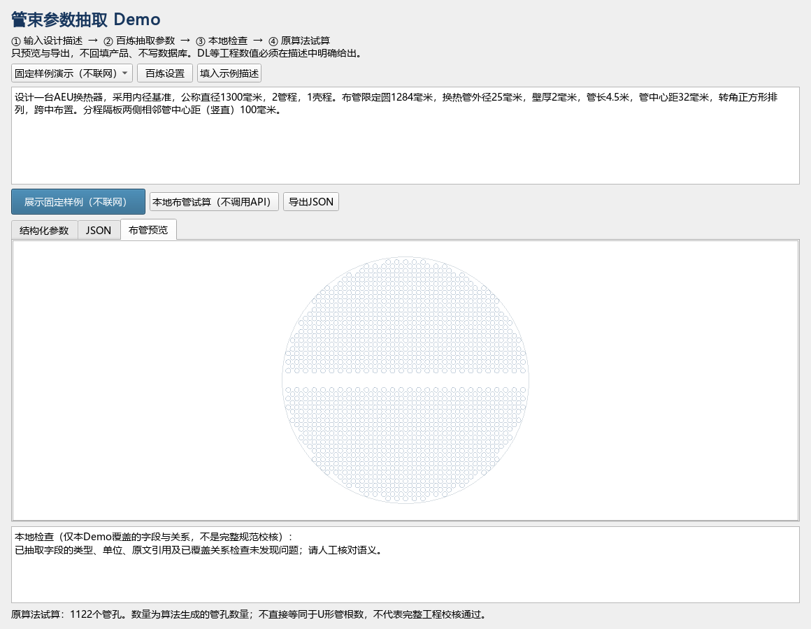

# 管束 AI 参数抽取 Demo：从零开始操作

适用版本：2026-10-20，阿里云百炼版。先读第2～5节，就可以演示。

## 1. 先弄懂我们在做什么

可以把 AI Agent 理解为“听懂你的要求，再调用程序工具的小助手”。模型负责理解语言，工具负责真正执行计算。现有布管程序就是可以交给助手使用的一种工具。

师兄说的“先看看能抽出来结构化参数”，是第一步：把一句中文变成程序认识的数据。例如：

> AEU，公称直径1300毫米，换热管外径25毫米，管长4.5米。

变成：

```json
{
  "产品型式": "AEU",
  "公称直径 DN": 1300,
  "换热管外径 do": 25,
  "换热管公称长度 LN": 4500
}
```

JSON就是一种有固定结构的文本格式。这里长度统一用毫米。程序还会保存每个值对应的原文，方便你检查模型有没有理解错。

这个版本是Agent的第一步原型：**自然语言 → 参数抽取 → 本地检查 → 调用布管工具预览**。不是完整自主设计系统，也没有训练新模型。模型使用百炼提供的千问服务。

## 2. 怎么打开

### 最方便的方法

在项目根目录双击 **启动管束AI演示.cmd**。

启动脚本会优先使用当前机器已验证的 `D:\ProgramData\anaconda3\python.exe`，找不到时使用系统PATH中的 `python`。如需指定其他解释器，可设置环境变量 `DONG_LANPEC_PYTHON` 为完整的 `python.exe` 路径。脚本已使用Windows CRLF换行；失败时会停留在错误窗口，不会立即关闭。

会出现“东蓝管束 · AI参数抽取Demo（阿里云百炼）”窗口。这个独立入口不用创建项目，不连接产品数据库，不需要工程计算DLL。

也可以在项目根目录终端运行：

```powershell
python run_tube_ai_demo.py
```

如果你正在运行原软件：进入“管束设计”，点击底部 **AI 助手**，选择 **参数抽取 Demo** 页签。它与独立入口使用同一套抽取代码；额外显示当前页面值作只读对照。

### 如果启动失败

要使用能运行当前工程的 Python 环境。当前机器已验证的解释器是：

```powershell
& 'D:\ProgramData\anaconda3\python.exe' '.\run_tube_ai_demo.py'
```

如果换一台电脑，独立Demo需要 Python 3.10+ 和 PyQt5；不要求安装 openai、dashscope、LangChain 等SDK：

```powershell
python -m pip install PyQt5
```

本仓库自带的 `venv` 记录了另一台机器的旧路径，本机不能直接用它启动；不要因此去删除原环境。

## 3. 不花 API 费用，先熟悉界面

1. 顶部下拉框选择 **固定样例演示（不联网）**。
2. 点击 **填入示例描述**。
3. 点击 **展示固定样例（不联网）**。
4. “结构化参数”中会出现13项参数与原文依据；点“JSON”看完整结构。
5. 点击 **本地布管试算（不调用API）**，查看布管预览。

这一路径使用写在程序中的固定样例响应，**没有调用真实AI，也不能解析其他任意输入**。它用来先熟悉交互、验证本地计算链路。固定样例在本机原算法中生成1122个管孔；管孔数量不是U形管根数。



## 4. 配置阿里云百炼，开始真正的AI解析

### 准备的东西

你已有百炼 API Key。需要复制完整密钥；截图中带星号的遮挡文本不能用于请求。使用百炼的 API Key，不使用阿里云账号的 AccessKey ID / AccessKey Secret。

**不要把密钥发送到聊天、写进代码或放到汇报截图中。** 直接粘贴到Demo的密码框即可。

### 填写设置

1. 点击 **百炼设置**。
2. 填写下表。
3. 点击 **保存设置（不调用API）**。

| 设置项 | 怎么填 |
| --- | --- |
| Base URL | 北京地域先使用默认 `https://dashscope.aliyuncs.com/compatible-mode/v1` |
| 模型名称 | 先用 `qwen-plus`；该模型须在你的业务空间有调用权限 |
| API Key | 粘贴完整百炼密钥，只在密码框里输入 |

百炼也提供业务空间专属域名，例如 `https://实际业务空间ID.cn-beijing.maas.aliyuncs.com/compatible-mode/v1`。可以从控制台取得后替换默认地址，不能保留“实际业务空间ID”或 `{WorkspaceId}` 这些占位符。地址和密钥必须属于同一地域；新加坡等地域请填写官方提供的对应地址。官方说明旧域名仍可使用。[百炼兼容接口配置](https://help.aliyun.com/zh/model-studio/compatibility-of-openai-with-dashscope)

密钥只保留在当前程序内存中，关闭程序后需要重新输入。地址和模型名保存在 `%APPDATA%\DongLanpec\ai_assistant.json`，新设置界面不会把密钥写进去。设置时不请求模型。

如果你已经熟悉环境变量，也支持 `DASHSCOPE_API_KEY`；此外兼容旧助手的 `DONG_LANPEC_AI_API_KEY`、`DONG_LANPEC_AI_BASE_URL`、`DONG_LANPEC_AI_MODEL`。

### 第一次真实请求

1. 顶部模式切到 **百炼真实解析**。
2. 点击 **填入示例描述**，先不要修改文字。
3. 点击 **开始抽取（调用1次API）**。
4. 等待返回。网络请求在后台进行，不会自动重试。
5. 检查模式显示“百炼真实解析”，而不是“固定样例”。
6. 查看13项左右的参数，逐项对照原文；例如“管长4.5米”应转换为4500 mm。
7. 参数齐全且检查未发现问题时，点击本地试算。

一次“开始抽取”对应一次模型请求。设置、固定样例、本地试算和导出都不调用模型。真实请求按百炼账号的计费/赠送额度规则处理；界面展示服务端返回的输入与输出token数量，不估算人民币金额。不要根据账号首页余额推断具体模型一定可调用。[模型价格与计费说明](https://help.aliyun.com/zh/model-studio/model-pricing)

## 5. 给师兄演示：建议按这三段来

### 演示A：完整描述变成参数

选择“百炼真实解析”，输入：

```text
设计一台AEU换热器，采用内径基准，公称直径1300毫米，2管程，1壳程。
布管限定圆1284毫米，换热管外径25毫米，壁厚2毫米，管长4.5米，
管中心距32毫米，转角正方形排列，跨中布置。
分程隔板两侧相邻管中心距（竖直）100毫米。
```

演示要点：

- 模型把自然语言映射成程序里的规范参数名。
- 原文“4.5米”转换成4500毫米；每项都有原文依据。
- DL=1284是描述中明确提供的输入，不是模型计算出的工程结论。
- 本地检查后，原有布管算法生成预览，模型不输出坐标。
- 点“导出JSON”，将结果保存到桌面，作为师兄能直接检查的演示材料。

### 演示B：信息不足时不瞎填

输入：

```text
设计一台AEU换热器，换热管外径25毫米，管长4.5米。
```

预期：只抽取明确给出的字段。DL、间距、排列方式等保持缺失；点击试算会提示补充信息，不把样例参数偷偷填进来。

### 演示C：模型提取与工程检查各做各的事

把演示A的“管中心距32毫米”改成“管中心距20毫米”，重新抽取。

预期：模型可以提取出20，但本地检查指出“中心距小于换热管外径”，拒绝试算。这个例子能说明“提取成JSON”和“工程可用”是两个不同的检查层次。

你可以这样汇报：

> 目前完成了管束参数抽取Demo。百炼千问将自然语言提取成带原文依据的JSON，本地程序负责字段、单位与部分关系检查，再调用现有布管算法做只读预览。没给的参数不补默认值，冲突会拦截。下一步先收集真实描述评估抽取准确率，再决定哪些字段可以安全回填。

## 6. 现在能做什么，不能做什么

| 功能 | 当前能力 |
| --- | --- |
| 抽取字段 | 产品型式、内/外径基准、DN、DL、管/壳程数、外径、壁厚、中心距、管长、排列方式、布置方式、水平/竖直分程间距，共14种字段 |
| 单位 | 模型将长度换算成mm，本地检查单位与有限数值；语义与换算正确性还需人工对照 |
| 来源 | 每个字段必须给出原文中的连续片段；不存在的引用会被拒绝 |
| 缺失/歧义 | 未提到的字段缺失；模型识别出的冲突、歧义或不支持内容列为待澄清 |
| 试算 | 第一版开放1/2管程，必须明确提供DL、外径、中心距、排列/布置方式；2管程还需竖直分程间距 |
| 多管程 | 可以抽取4/6/8等管程数，但此Demo不擅自选择具体分程型式，因此不开放该类试算 |
| 自动改产品 | 参数抽取页不回填、不保存、不操作产品数据库 |
| 完整设计/规范校核 | 尚未实现；“已覆盖检查未发现问题”不等于“设计合格” |

如果文字包含材料、压力、温度或元件位置等本版本不支持的内容，会要求澄清或移除这些内容后再试算。结构化输出可能理解错误；不能把模型生成的值直接当作批准的设计数据。

原“布管方案”“元件方案”页签保留先前功能，它们有各自的应用按钮。首次演示建议只使用新“参数抽取 Demo”页签。

## 7. 常见问题

| 现象 | 怎么处理 |
| --- | --- |
| 提示未配置 | 打开“百炼设置”，填写完整API Key；确认已经保存 |
| HTTP 401 | 检查密钥、是否误复制了星号遮挡文本、密钥地域和Base URL是否匹配 |
| HTTP 403 | 检查业务空间权限和所选模型是否已开通 |
| HTTP 404 | 检查模型名与URL；Base URL以 `/compatible-mode/v1` 结尾即可 |
| HTTP 400 | 检查所选模型是否支持JSON及非思考模式；先恢复 `qwen-plus` 测试 |
| HTTP 429 | 到百炼控制台检查限流、可用额度和账单；程序不会自动重试 |
| 超时/连接失败 | 检查网络与地址；恢复后自己点击重试即可 |
| 提示依据不在原文/参数格式错误 | 该响应被拒绝，没有写入设计；把描述写清楚后重试，不会自动发第二次请求 |
| 提示试算缺少参数 | 回到原文补充该参数，再重新抽取；不是在JSON里直接改数 |
| 改了描述，旧结果消失 | 正常。避免拿旧参数解释新描述 |
| 请求期间换了产品/修改描述 | 返回的旧结果会丢弃，重新抽取即可 |
| 请求期间不能关闭窗口 | 等返回或超时后关闭，避免销毁尚在运行的网络线程 |

## 8. 已验证与待验证

本次交付已用固定样例、模拟HTTP返回和Qt界面测试验证抽取合约、错误拦截、异步结果失效、JSON导出和原算法试算；没有读取你的完整百炼密钥，也没有代替你发起真实计费请求。

全套40项自动测试通过（含实际CMD启动、跨目录及带空格输出路径、启动失败诊断测试），Python编译与Git差异检查通过。固定样例导出可查看 [管束参数抽取-固定样例.json](examples/管束参数抽取-固定样例.json)；它明确标记为不联网样例。

**真实API验收由你按第4节输入密钥后完成。** 如果请求失败，把错误码和页面提示发给我即可，截图时不要包含密钥。不能把固定样例测试说成真实模型测试通过。

官方参考（核对日期：2026-10-20）：[百炼结构化输出](https://help.aliyun.com/zh/model-studio/qwen-structured-output)、[接口与地域配置](https://help.aliyun.com/zh/model-studio/compatibility-of-openai-with-dashscope)、[获取API Key](https://help.aliyun.com/zh/model-studio/get-api-key)。
