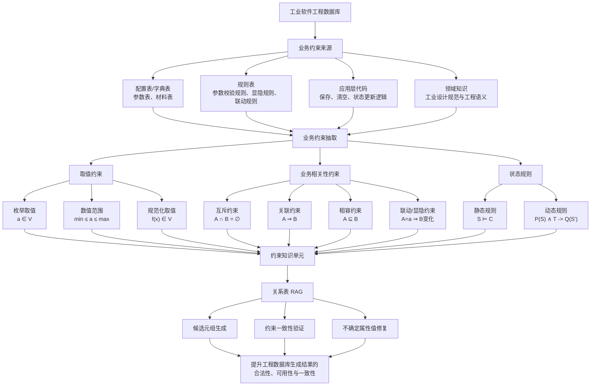

# 业务约束论文插图整理

## 1. 业务约束总体定义

业务约束是由应用领域语义、工业设计逻辑和应用层业务流程决定的约束。它通常不直接表现为数据库中的主键、外键、非空、类型等显式规则，而是隐含在：

- 配置表、字典表、规则表；
- 应用程序业务逻辑；
- 领域知识和工程设计规范；
- 数据对象之间的组合关系、状态转换关系中。

在工业软件工程数据库中，业务约束主要用于保证生成数据满足领域语义、工程计算调用要求和设计过程一致性。

## 2. 业务约束分类框架

### 2.1 按语义特征分类

业务约束可分为两大类：

| 一级类别 | 二级类别 | 语义含义 | 形式化表达 | 典型例子 |
|---|---|---|---|---|
| 取值约束 | 枚举取值约束 | 属性值必须来自合法集合 | a ∈ V | `材料类型 ∈ {钢板, 钢管, 钢锻件, 焊材...}` |
| 取值约束 | 数值范围约束 | 数值必须满足上下界或正负规则 | min ≤ a ≤ max / a > 0 | `滑道与竖直中心线夹角 ∈ [15°,25°]` |
| 取值约束 | 规范化取值约束 | 输入表达需映射为系统标准值 | f(x) ∈ V | `Q345R钢板 -> 材料类型=钢板` |
| 业务相关性约束 | 互斥约束 mutex | 两个属性值或实体不能同时成立 | A ∩ B = ∅ | 球冠形封头管/壳侧覆层材料类型互斥 |
| 业务相关性约束 | 关联约束 requires | A 存在时 B 必须存在 | A ⇒ B | 若有材料牌号，则必须有材料类型、材料标准、供货状态 |
| 业务相关性约束 | 相容约束 compatible/subset | 候选集合必须属于允许集合 | A ⊆ B | 元件材料候选必须来自该元件允许材料集合 |
| 业务相关性约束 | 联动约束 dependency | 一个属性值决定另一个属性的候选或默认值 | A=a ⇒ B∈Vb | `支座型式=鞍式支座 -> 支座标准∈{NB/T 47065.1, 非标支座}` |
| 业务相关性约束 | 显隐约束 visibility | 一个属性值决定另一个属性是否参与定义 | A=a ⇒ show/hide(B) | `是否添加覆层=否 -> 隐藏覆层材料字段` |

### 2.2 按状态转换分类

| 类别 | 含义 | 形式化表达 | 例子 |
|---|---|---|---|
| 静态规则 | 某一时刻数据状态必须满足的不变条件 | S ⊨ C | `材料类型、材料牌号、材料标准、供货状态` 的组合必须存在于材料库 |
| 动态规则 | 事务执行前后状态必须满足的条件 | P(S) ∧ T -> Q(S') | 元件由“未定义”转为“已定义”前，必填参数必须完整 |

## 3. 面向元件附加参数表的约束归纳

### 3.1 取值约束

| 约束对象 | 约束内容 | 约束来源 | 类型 |
|---|---|---|---|
| 参数值下拉项 | 参数值必须来自 `材料库.参数表` 中配置的 JSON 候选集合 | 字典表 | 枚举取值 |
| 材料四字段 | `材料类型/材料牌号/材料标准/供货状态` 必须来自 `材料库.材料表` 的合法组合 | 材料表 | 枚举组合 |
| 覆层开关 | `是否添加覆层` 只能取 `是/否` | 代码逻辑/参数表 | 枚举取值 |
| 数值型参数 | 参数需满足 `gt0/ge0/range` 规则 | `参数校验规则表` | 数值范围 |
| 程序推荐参数 | 部分参数清空后需置回 `程序推荐` | `参数程序推荐置回表` 和代码 | 规范化取值 |

### 3.2 业务相关性约束

| 约束名称 | 约束表达 | 约束含义 | 约束类型 |
|---|---|---|---|
| 材料四字段完整性 | `材料牌号存在 -> 材料类型 ∧ 材料标准 ∧ 供货状态存在` | 材料数据必须可被后续计算模块识别 | requires |
| 材料组合相容 | `(材料类型, 材料牌号, 材料标准, 供货状态) ∈ 材料库.材料表` | 四字段组合不能任意拼接 | compatible |
| 锻件级别显隐 | `材料类型=钢锻件 -> 显示锻件级别`；否则隐藏并清空 | 锻件级别只对锻件材料有效 | visibility/requires |
| 覆层字段关联 | `是否添加覆层=是 -> 覆层材料类型/牌号/级别/标准应完整` | 添加覆层时必须定义覆层材料 | requires |
| 覆层工艺联动 | `覆层材料类型=焊材 -> 覆层成型工艺=堆焊` | 焊材覆层只能采用堆焊工艺 | dependency |
| 覆层工艺联动 | `覆层材料类型∈{钢板,板材} -> 覆层成型工艺∈{爆炸焊接,轧制复合}` | 板材覆层工艺受限 | dependency |
| 球冠形封头覆层互斥 | 管程侧覆层材料类型与壳程侧覆层材料类型在板材/焊材之间互斥 | 两侧覆层类型不能同时落入同类 | mutex |
| 垫片程序推荐 | 垫片尺寸、PN 为空 -> 写回 `程序推荐` | 允许计算模块自动推荐 | dependency |
| 管箱垫片成对同步 | 保存 `管箱垫片` -> 同步 `管箱侧垫片` 非名称参数 | 成对元件参数保持一致 | dependency |
| 支座子元件完整性 | `支座型式=鞍式支座 -> {底板,腹板,筋板,垫板}` 必须完整 | 支座定义依赖子元件集合 | requires |
| 铭牌完整性 | 铭牌必须包含 `铭牌支架/铭牌板/铆钉` 且材料完整 | 合并元件由多个子元件组成 | requires |
| 保温装置完整性 | 保温装置必须包含 `支撑板/支撑环/支撑条/螺母/螺柱` 且材料完整 | 合并元件组合完整性 | requires |

## 4. 动态规则抽象

动态规则适合表达“状态能否改变”的条件。

| 事务 T | 前提条件 P(S) | 后置条件 Q(S') | 含义 |
|---|---|---|---|
| 保存普通元件参数 | 当前元件存在，参数行存在 | 活动库参数值被更新 | 普通保存不补插缺失参数 |
| 清空普通元件参数 | 用户确认清空 | 非保留参数清空；名称类参数保留 | 清空不是删除结构 |
| 元件定义状态更新 | 可见必填参数均非空 | `定义状态=已定义` | 必填项决定定义状态 |
| 模板切换 | 选择新模板 | 删除旧产品参数并按模板重建参数 | 模板决定参数结构 |
| 覆层开关切换 | 覆层开关变化 | 覆层字段显示/隐藏，但隐藏值不清空 | 显隐不等于删除数据 |
| 支座型式切换 | 支座型式变化 | 更新支座标准、支座型号、元件名称候选 | 支座参数联动 |

形式化表示示例：

```text
P(S): required_params(element) 均已填写
T: update_definition_status(element)
Q(S'): element.定义状态 = 已定义
```

若 `P(S)` 不成立，则 `Q(S')` 不允许成立，即不能将元件定义状态更新为“已定义”。

## 5. 约束知识单元表示

后续构建关系表 RAG 时，可以把每条业务约束表示为可检索知识单元：

| 字段 | 含义 | 示例 |
|---|---|---|
| constraint_id | 约束编号 | C_MAT_001 |
| source_table | 约束来源表 | `材料库.材料表` |
| source_code | 约束来源代码 | `install_material_delegate_linkage` |
| constraint_type | 约束类型 | value / mutex / requires / compatible / dependency / visibility / dynamic |
| subject | 约束主体 | 材料四字段 |
| condition | 触发条件 | `材料类型=钢锻件` |
| rule | 约束规则 | `锻件级别必须显示且可选` |
| action | 校验或修复动作 | 非钢锻件时隐藏并清空 |
| target_relation | 作用关系表 | `产品设计活动表_元件附加参数表` |

## 6. 论文插图建议结构

建议论文插图分为四层：

1. **数据/代码来源层**：配置表、字典表、规则表、应用代码、领域知识。
2. **约束抽取层**：取值约束、业务相关性约束、静态规则、动态规则。
3. **约束知识化层**：转换为 RAG 可检索约束知识单元。
4. **应用层**：候选元组生成、约束一致性验证、不确定属性修复。

## 7. Mermaid 插图草稿



## 8. 图中可放置的元件附加参数示例

可在图右侧附一个小型案例框：

```text
案例：元件附加参数表

材料牌号存在
    -> 必须存在材料类型、材料标准、供货状态
    -> 四字段组合必须属于材料库.材料表

是否添加覆层 = 是
    -> 覆层材料类型/牌号/级别/标准必须完整
    -> 覆层材料类型 = 焊材 时，成型工艺 = 堆焊

元件必填参数完整
    -> 允许 定义状态: 未定义 -> 已定义
```

