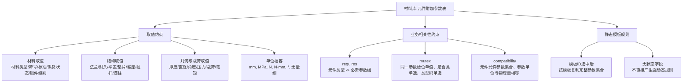

# 材料库.元件附加参数表业务约束分类清单

## 0. 范围与依据

本文只整理 `材料库.元件附加参数表` 一张表中的业务约束，不包含管口附加参数表、合并元件附加参数表、产品设计活动库中的实例表，也不展开 RAG 总体框架。

代码侧依据为 `modules/cailiaodingyi/funcs/funcs_pdf_input.py`：

- `load_element_para_data(template_id)` 按 `模板ID` 从 `材料库.元件附加参数表` 读取 `元件附加参数ID、元件ID、元件名称、参数名称、参数数值、参数单位`。
- `insert_element_para_data(product_id, guankou_para_info)` 将上述模板参数写入活动库实例表，说明该表是普通元件附加参数的模板规则来源。

数据库侧当前统计：

| 项 | 数量 |
|---|---:|
| 行数 | 13921 |
| 模板数 | 33 |
| 元件ID数 | 401 |
| 元件名称数 | 84 |
| 参数名称数 | 159 |

因此，本文将表中每一行理解为一个规则原子：

```text
(模板ID, 元件ID, 元件名称, 参数名称) -> (参数数值, 参数单位)
```

在业务语义上，`模板ID + 元件ID + 元件名称` 确定一个模板内元件，`参数名称` 确定该元件应具备的附加参数槽位，`参数数值` 和 `参数单位` 给出默认值、枚举值或待定义占位。

## 1. 取值约束

取值约束表示某一 `参数名称` 的合法非空取值集合或单位集合。表中空值通常表示待定义、继承、程序推荐或当前模板未启用，不应直接视为一个合法工程取值。

### 1.1 标识与材料取值

| 参数名称 | 约束 |
|---|---|
| 元件名称 | `参数名称 = 元件名称` 的行中，`参数数值` 应与同一行的 `元件名称` 一致，用于标识该元件参数组。 |
| 材料类型 | 非空值只能属于 `{钢板, 钢棒, 钢管, 钢锻件}`。 |
| 材料牌号 | 非空值只能属于 `{16Mn, 20, 20(GB9948), 30CrMo, 35CrMo, Q235B, Q345R, Q355, S30403, S30403(GB13296), S30408}`。 |
| 材料标准 | 非空值只能属于 `{GB/T 1220, GB/T 13296, GB/T 1591-2018, GB/T 24511, GB/T 3077, GB/T 3274, GB/T 3274-2017, GB/T 699, GB/T 700, GB/T 713.2, GB/T 713.7, GB/T 9948, NB/T 47008, NB/T 47010}`。 |
| 供货状态 | 非空值只能属于 `{固溶, 正火, 热轧, 调质}`。 |
| 锻件级别 | 非空值只能属于 `{Ⅱ, Ⅲ}`。 |
| 材料级别 | 非空值只能为 `{Ⅰ}`，出现在换热管/U形换热管参数组。 |
| 质量等级 | 非空值只能为 `{B}`，出现在加强圈参数组。 |

### 1.2 覆层取值

普通覆层参数出现在 25 类元件名称上，包括圆筒、封头、法兰、平盖、锥壳等壳体/管箱/外头盖相关元件。

| 参数名称 | 约束 |
|---|---|
| 是否添加覆层 | 非空默认值为 `{否}`；业务上属于布尔标志位，只能在 `{是, 否}` 中取一值。 |
| 覆层材料类型 | 非空值为 `{钢板}`。 |
| 覆层材料牌号 | 非空值为 `{S31603}`。 |
| 覆层材料级别 | 非空值为 `{1E}`。 |
| 覆层材料标准 | 非空值为 `{GB/T 713.7}`。 |
| 覆层成型工艺 | 非空值为 `{爆炸焊接}`。 |
| 覆层使用状态 | 非空值为 `{固溶}`。 |
| 覆层厚度 | 单位应为 `mm`，数值为空时表示待定义。 |
| 存在覆层时的焊接凹槽深度 | 单位应为 `mm`，非空默认值为 `{2}`。 |

双侧覆层参数只出现在 `{固定管板, 浮动管板, 浮头法兰, 球冠形封头}` 上。

| 参数组 | 约束 |
|---|---|
| 管程侧是否添加覆层、壳程侧是否添加覆层 | 非空默认值均为 `{否}`；每侧只能在 `{是, 否}` 中取一值。 |
| 管程侧/壳程侧覆层材料类型、牌号、级别、标准、成型工艺、使用状态 | 与对应侧的覆层标志共现；表内多数为空，表示待定义或未启用。 |
| 管程侧/壳程侧覆层厚度 | 单位应为 `mm`。 |
| 管程侧/壳程侧存在覆层时的焊接凹槽深度 | 单位应为 `mm`，非空默认值为 `{2}`。 |
| 管程侧/壳程侧腐蚀裕量 | 单位应为 `mm`，非空值属于 `{0, 3}`。 |

### 1.3 垫片取值

垫片参数出现在 7 类元件名称上：`前端管箱平盖垫片、外头盖垫片、平盖垫片、浮头垫片、管箱侧垫片、管箱垫片、设备法兰垫片`。

| 参数名称 | 约束 |
|---|---|
| 垫片类型 | 非空值为 `{金属波齿复合垫片}`。 |
| 垫片标准 | 非空值为 `{GB/T 29463-2023}`。 |
| 垫片材料 | 非空值为 `{复合柔性石墨波齿金属板：不锈钢及镍基合金}`。 |
| 垫片结构型式代号 | 非空值为 `{基本型结构（A）}`。 |
| 填充材料 | 非空值为 `{柔性石墨板}`。 |
| 金属材料 | 非空值为 `{S30408}`。 |
| 公称压力PN | 非空值为 `{程序推荐}`，单位应为 `MPa` 或空。 |
| 压紧面形状 | 非空值为 `{1a}`。 |
| 垫片厚度 | 单位应为 `mm`，非空值为 `{4.5}`。 |
| 垫片名义内径D1n | 单位应为 `mm`，非空值为 `{825}`。 |
| 垫片名义外径D2n | 单位应为 `mm`，非空值为 `{865}`。 |
| 环内径d1 | 单位应为 `mm`，非空值为 `{805}`。 |
| 垫片比压力y | 单位应为 `MPa`，非空值为 `{50}`；表中存在 `mm` 单位记录，应作为单位相容性修复点。 |
| 垫片系数m | 无量纲，非空值属于 `{3, 3.0}`；表中存在 `mm` 单位记录，应作为单位相容性修复点。 |
| 垫片与密封面接触内径D1、垫片与密封面接触外径D2 | 仅 `管箱垫片` 出现，单位应为 `mm`。 |

### 1.4 法兰、平盖、封头与锥壳取值

| 参数组 | 约束 |
|---|---|
| 法兰类型 | 非空值为 `{NB/T 47023 长颈对焊法兰}`，出现在 7 类法兰元件上。 |
| 法兰密封面 | 非空值属于 `{凸密封面M, 凹密封面FM}`，同一法兰元件只能取其中一种。 |
| 密封面高度 | 单位应为 `mm`，非空值为 `{6}`。 |
| 轴向拉伸载荷 | 单位应为 `N`，非空值为 `{0}`；表中存在 `mm` 单位记录，应作为单位相容性修复点。 |
| 附加弯矩 | 单位应为 `N·mm`，非空值为 `{0}`。 |
| 平盖类型 | 非空值为 `{9}`。 |
| 平盖密封面型式及代号 | 非空值为 `{凸密封面M}`。 |
| 装配凸台高度、隔板槽深度 | 单位应为 `mm`，非空值均为 `{6}`。 |
| 封头标准 | 非空值属于 `{GB/T 21598-2023, GB/T 25198-2023}`，同一封头元件只能取一个标准。 |
| 封头类型代号 | 非空值为 `{EHA（椭圆形封头）}`。 |
| 预设厚度1、预设厚度2、预设厚度3 | 单位应为 `mm`，非空默认值为 `{0}`。 |
| 封头外直径与浮头法兰内径差值 | 仅 `球冠形封头` 出现，单位 `mm`，非空值 `{2}`。 |
| 封头焊入法兰深度 | 仅 `球冠形封头` 出现，单位 `mm`，非空值 `{程序推荐}`。 |
| 偏心锥壳与筒体间夹角大值 α1 | 仅 `锥壳` 出现，单位 `°`，非空值 `{程序推荐}`。 |
| 偏心锥壳与筒体间夹角小值 α2 | 仅 `锥壳` 出现，单位 `°`，非空值 `{0}`。 |
| 锥壳大端是否带折边、锥壳小端是否带折边 | 非空值均为 `{否}`；业务上只能在 `{是, 否}` 中取一值。 |
| 是否需要锥壳与大端连接处作为支撑线 | 非空值为 `{是}`。 |
| 是否需要锥壳与小端连接处作为支撑线 | 非空值为 `{否}`。 |
| 由外载荷在锥壳大端/小端产生的单位圆周长度上轴向力 | 非空值为 `{0}`，表内单位为空，应按业务字段定义补充单位。 |

### 1.5 管板、换热管、隔板与支承附件取值

| 参数组 | 约束 |
|---|---|
| 固定管板/浮动管板槽参数 | `管程侧分程隔板槽深度=6mm`，`管程侧分程隔板槽宽度=12mm`，`壳程侧分程隔板槽深度=0mm`，`壳程侧分程隔板槽宽度=0mm`。 |
| 管板削弱系数 | `管板刚度削弱系数=0.4`，`管板强度削弱系数=0.4`，为无量纲。 |
| 管板凸台/密封面 | `管板凸台高度=6mm`，`管板延长部分兼作法兰密封面高度=6mm`，`管板钩圈侧凸台高度=1.5mm`。 |
| 管壳程压力同时作用标志 | 非空值为 `{否}`，只能在 `{是, 否}` 中取一值。 |
| 换热管外径 | `25mm`；允许偏差 `+0.10，-0.10mm`。 |
| 管孔直径 | `25.25mm`；允许偏差 `+0.1，-0.1mm`。 |
| 管束级别 | 非空值为 `{Ⅰ}`。 |
| 分程隔板排净孔 | `隔板是否开排净孔=是`，`排净孔型式=边缘三角缺口`，`排净孔轴向定位x倍隔板轴向长度=0.5`。 |
| 分程隔板几何 | `三角缺口角度=90°`，`三角缺口高度=5mm`，`圆孔直径=5mm`。 |
| 分程隔板削边 | 平盖侧和管板侧均要求 `端部是否削边=是`，削边角度 `45`，削边长度 `15mm`，端部与密封面差值 `0.3mm`。表中削边角度单位记录为 `mm`，应修复为角度单位或无量纲角度字段。 |
| 折流/支持板 | `内折流板厚度、弓形折流板厚度、异形折流板厚度、支持板厚度、中间挡板厚度` 的非空值多为 `{程序推荐}`，单位 `mm`。 |
| 排气通液槽 | `是否开设排气通液槽=是`，`排气通液槽高度/高度h=10mm`。 |
| 导流筒 | `导流筒厚度=3mm`，`导流筒直边高度=20mm`，`倒圆半径=20mm`。 |
| 滑道 | `滑道与竖直中心线夹角=15°`，`滑道厚度=20mm`，`滑道高度=40mm`，`滑道定位=滑道与管板焊接`。 |
| 防冲板 | `防冲板厚度=10mm`，`防冲板宽度=200mm`，`防冲板形式=圆弧形`，`折边角度=45°`，`方位角=0°`，`至圆筒内壁距离=150mm`。 |
| 拉杆 | `拉杆型式=螺纹拉杆`，`拉杆规格=程序推荐`，`配套螺母数量=x2`。 |
| 螺柱 | `螺柱型式=（B）缩径双头螺柱`，`螺柱根径系列=GB`。 |
| 鞍座 | `鞍座型式代号=BⅠ`，`鞍座高度h=200mm`。 |
| 接地装置 | `装置类型=接地片`。 |
| 加强圈 | `加强圈位置=外加强圈`，`质量等级=B`。 |
| 纵向隔板 | `纵向隔板与壳体的连接型式=a`，`纵向隔板与管板的连接型式=焊接连接`。 |
| 钩圈 | `钩圈型式=B`，`钩圈颈部厚度最小值=30mm`。 |

## 2. 业务相关性约束

### 2.1 关联约束 requires

这类约束表示某个参数或元件类型出现时，另一组参数必须同时出现。

| 编号 | 触发条件 | 必须共现的参数 |
|---|---|---|
| R1 | 元件具有材料属性 | `材料类型、材料牌号、材料标准、供货状态` 必须作为一组出现；若为锻件语义，还应出现 `锻件级别`。 |
| R2 | 出现 `材料类型=钢锻件` 或元件为法兰/管板/封头等锻件候选 | 必须具备 `锻件级别`，非空时只能为 `Ⅱ` 或 `Ⅲ`。 |
| R3 | 出现 `是否添加覆层` | 必须同时具备普通覆层组：`覆层材料类型、覆层材料牌号、覆层材料级别、覆层材料标准、覆层成型工艺、覆层使用状态、覆层厚度、存在覆层时的焊接凹槽深度`。 |
| R4 | `是否添加覆层=是` | `覆层材料类型、覆层材料牌号、覆层材料标准、覆层厚度、覆层成型工艺、覆层使用状态` 不应为空；`存在覆层时的焊接凹槽深度` 应有 `mm` 数值。 |
| R5 | 元件为 `{固定管板, 浮动管板, 浮头法兰, 球冠形封头}` | 必须具备管程侧与壳程侧两套覆层参数、两侧腐蚀裕量、两侧焊接凹槽深度。 |
| R6 | 元件为 `{固定管板, 浮动管板}` | 必须具备管程侧/壳程侧分程隔板槽宽度与深度、管壳程压力同时作用标志，以及管板削弱系数。 |
| R7 | 元件名称包含 `垫片` | 必须具备垫片组：`垫片类型、垫片标准、垫片材料、垫片结构型式代号、填充材料、金属材料、公称压力PN、压紧面形状、垫片厚度、垫片名义内径D1n、垫片名义外径D2n、环内径d1、垫片比压力y、垫片系数m`。 |
| R8 | 元件为 `管箱垫片` | 在通用垫片组之外，还应具备 `垫片与密封面接触内径D1、垫片与密封面接触外径D2`。 |
| R9 | 元件为法兰类 `{前端管箱头盖法兰, 壳体法兰, 外头盖侧法兰, 外头盖法兰, 头盖法兰, 管箱法兰, 设备法兰}` | 必须具备 `法兰类型、法兰密封面、密封面高度、轴向拉伸载荷、附加弯矩`，并与材料组和覆层组共现。 |
| R10 | 元件为平盖类 `{前端管箱平盖, 平盖, 管箱平盖}` | 必须具备 `平盖类型、平盖密封面型式及代号、装配凸台高度、隔板槽深度`，并与材料组和覆层组共现。 |
| R11 | 元件为封头类 `{后端管箱封头, 壳体封头, 外头盖封头, 封头, 管箱封头}` | 必须具备 `封头标准、封头类型代号、预设厚度1、预设厚度2、预设厚度3`，并与材料组和覆层组共现。 |
| R12 | 元件为 `球冠形封头` | 必须具备 `封头外直径与浮头法兰内径差值、封头焊入法兰深度`，同时具备管/壳程两侧覆层与腐蚀裕量参数。 |
| R13 | 元件为 `锥壳` | 必须具备锥壳角度、折边标志、支撑线标志、外载荷轴向力参数，并与材料组和覆层组共现。 |
| R14 | 元件为 `分程隔板` | 必须具备排净孔、三角缺口、圆孔直径、平盖侧/管板侧削边参数。 |
| R15 | 元件为 `{换热管, U形换热管}` | 必须具备 `换热管外径、换热管外径允许偏差、管孔直径、管孔直径允许偏差、管束级别、材料级别`。 |
| R16 | 元件为 `拉杆` | 必须具备 `拉杆型式、拉杆规格、配套螺母数量`。 |
| R17 | 元件为 `{固定鞍座, 滑动鞍座}` | 必须具备 `鞍座型式代号、鞍座高度h`。 |
| R18 | 元件为 `{外头盖吊耳, 管箱吊耳}` 且出现 `是否带垫板` | 必须具备 `垫板材料类型、垫板材料牌号、垫板材料标准、垫板材料供货状态`。 |

### 2.2 互斥约束 mutex

| 编号 | 互斥对象 | 约束说明 |
|---|---|---|
| M1 | 同一 `(模板ID, 元件ID, 参数名称)` 的多条记录 | 同一模板内同一元件的同一参数槽位应唯一，不能同时存在多个不同值。当前表内可观察到少量重复槽位，应作为数据清洗项。 |
| M2 | 所有 `是否...` 参数的 `是/否` 取值 | 布尔标志位不能同时为 `是` 和 `否`。涉及 `是否添加覆层、管程侧是否添加覆层、壳程侧是否添加覆层、是否带垫板、是否开设排气通液槽、隔板是否开排净孔、隔板平盖侧端部是否削边、隔板管板侧端部是否削边、锥壳大端是否带折边、锥壳小端是否带折边、是否需要锥壳与大端连接处作为支撑线、是否需要锥壳与小端连接处作为支撑线、是否可以保证在任何情况下管壳程压力都能同时作用`。 |
| M3 | `法兰密封面` 的 `{凸密封面M, 凹密封面FM}` | 同一法兰元件的密封面型式只能取一种。 |
| M4 | `封头标准` 的 `{GB/T 21598-2023, GB/T 25198-2023}` | 同一封头元件同一模板下只能绑定一个封头标准。 |
| M5 | `法兰类型、平盖类型、鞍座型式代号、钩圈型式、装置类型` | 这些类型码参数在同一元件参数组内均为单值选择，不允许多类型并存。 |
| M6 | 管程侧覆层组与壳程侧覆层组的内部取值 | 两侧不是互斥关系，但每一侧内部的 `是否添加覆层` 只能有一个布尔状态。 |

当前表内需要关注的唯一性异常：

| 模板ID | 元件ID | 元件名称 | 参数名称 | 重复数 |
|---:|---:|---|---|---:|
| 4 | 409 | 固定管板 | 管程侧分程隔板槽宽度 | 2 |
| 10 | 666 | 固定管板 | 管程侧分程隔板槽深度 | 2 |
| 10 | 666 | 固定管板 | 壳程侧分程隔板槽深度 | 2 |
| 27 | 554 | 腹板（滑动鞍座） | 元件名称 | 2 |

### 2.3 相容约束 compatibility

相容约束表示“参数集合必须属于元件允许参数集合”或“单位必须与参数物理量相容”。

| 编号 | 相容关系 | 约束说明 |
|---|---|---|
| C1 | 元件名称 -> 参数名称集合 | 每类元件只能出现该表中已经定义过的参数名称集合；例如垫片元件只能出现垫片组参数，不应出现法兰载荷或管板削弱系数。 |
| C2 | 法兰类元件 -> 法兰参数集合 | `{前端管箱头盖法兰, 壳体法兰, 外头盖侧法兰, 外头盖法兰, 头盖法兰, 管箱法兰, 设备法兰}` 的附加参数集合应包含法兰类型、密封面、载荷、弯矩、密封面高度，并与材料/覆层组相容。 |
| C3 | 垫片类元件 -> 垫片参数集合 | 7 类垫片元件的参数集合应包含垫片结构、材料、尺寸、系数和比压力，不应混入材料牌号/供货状态等金属元件材料组。 |
| C4 | 管板类元件 -> 双侧覆层/槽参数集合 | 固定管板和浮动管板必须与管程侧、壳程侧两套覆层/腐蚀/分程隔板槽参数相容。 |
| C5 | 覆层参数 -> 覆层元件集合 | 普通覆层组只能出现在圆筒、封头、法兰、平盖、锥壳等 25 类可覆层元件上；不应出现在垫片、鞍座、拉杆、螺柱等元件上。 |
| C6 | 单位 -> 参数物理量 | 长度/厚度/高度/深度/宽度/直径/距离/半径使用 `mm`；角度使用 `°`；压力使用 `MPa`；力使用 `N`；弯矩使用 `N·mm`；类型码、材料牌号、标准、状态、布尔值不应带物理单位。 |
| C7 | 程序推荐值 -> 可计算参数 | `程序推荐` 只适用于需要由后续计算或推荐逻辑确定的尺寸/规格类参数，如公称压力PN、拉杆规格、封头焊入法兰深度、堰板尺寸、支持板/挡板厚度等，不应写入材料牌号、标准、类型码等枚举字段。 |

表内可见的单位相容性修复点：

| 参数名称 | 应相容单位 | 表内观察到的异常 |
|---|---|---|
| 垫片比压力y | `MPa` | 出现 `mm`。 |
| 垫片系数m | 无量纲 | 出现 `mm`。 |
| 轴向拉伸载荷 | `N` | 出现 `mm`。 |
| 覆层使用状态、覆层成型工艺、覆层材料标准 | 无单位 | 出现 `mm`。 |
| 隔板平盖侧削边角度、隔板管板侧削边角度 | `°` 或无量纲角度字段 | 出现 `mm`。 |
| 压紧面形状、垫片结构型式代号 | 无单位 | 出现 `MPa`。 |

## 3. 静态规则与动态规则

`材料库.元件附加参数表` 是模板规则表，本身主要提供静态业务约束：

- 某类元件在某模板中应具备哪些参数。
- 每个参数的默认值、枚举值、单位或待定义状态。
- 参数组之间的共现关系和元件适用范围。

该表本身不保存状态迁移字段，因此不能直接抽取严格意义上的动态规则。若只针对本表，可表达的动态语义只有一条弱规则：

```text
当模板ID被选中并实例化为产品参数时，
该模板ID下的元件附加参数记录应作为一个完整参数集合被复制，
复制后不得丢失元件ID、元件名称、参数名称、参数数值、参数单位之间的对应关系。
```

如果论文图只画该表，建议将其归入“静态业务约束来源”，不要把产品状态更新、定义状态转换等动态规则画入本表约束中。

## 4. 可用于论文插图的约束分类



## 附录A. 159个参数名称全集按业务组归类

### A1 标识、材料与质量

`元件名称、材料类型、材料牌号、材料标准、供货状态、锻件级别、材料级别、质量等级`

### A2 普通覆层

`是否添加覆层、覆层材料类型、覆层材料牌号、覆层材料级别、覆层材料标准、覆层成型工艺、覆层使用状态、覆层厚度、存在覆层时的焊接凹槽深度`

### A3 管程侧/壳程侧覆层、腐蚀与管板

`管程侧是否添加覆层、管程侧覆层材料类型、管程侧覆层材料牌号、管程侧覆层材料级别、管程侧覆层材料标准、管程侧覆层成型工艺、管程侧覆层使用状态、管程侧覆层厚度、管程侧存在覆层时的焊接凹槽深度、管程侧腐蚀裕量、壳程侧是否添加覆层、壳程侧覆层材料类型、壳程侧覆层材料牌号、壳程侧覆层材料级别、壳程侧覆层材料标准、壳程侧覆层成型工艺、壳程侧覆层使用状态、壳程侧覆层厚度、壳程侧存在覆层时的焊接凹槽深度、壳程侧腐蚀裕量、管程侧分程隔板槽深度、管程侧分程隔板槽宽度、壳程侧分程隔板槽深度、壳程侧分程隔板槽宽度、是否可以保证在任何情况下管壳程压力都能同时作用、壳程圆筒环向焊接接头系数、管板凸台高度、管板刚度削弱系数、管板强度削弱系数、管板延长部分兼作法兰密封面高度、管板钩圈侧凸台高度、螺栓孔边缘至密封槽最小距离`

### A4 垫片

`公称压力PN、压紧面形状、垫片类型、垫片标准、垫片材料、垫片结构型式代号、垫片厚度、垫片名义内径D1n、垫片名义外径D2n、垫片比压力y、垫片系数m、填充材料、金属材料、环内径d1、垫片与密封面接触内径D1、垫片与密封面接触外径D2`

### A5 法兰、密封与外载

`法兰类型、法兰密封面、密封面高度、密封槽深度、轴向拉伸载荷、附加弯矩`

### A6 平盖、封头、锥壳与厚度预设

`平盖类型、平盖密封面型式及代号、装配凸台高度、隔板槽深度、封头标准、封头类型代号、封头外直径与浮头法兰内径差值、封头焊入法兰深度、预设厚度1、预设厚度2、预设厚度3、偏心锥壳与筒体间夹角大值 α1、偏心锥壳与筒体间夹角小值 α2、锥壳大端是否带折边、锥壳小端是否带折边、是否需要锥壳与大端连接处作为支撑线、是否需要锥壳与小端连接处作为支撑线、由外载荷在锥壳大端产生的单位圆周长度上轴向力、由外载荷在锥壳小端产生的单位圆周长度上轴向力`

### A7 换热管、管孔与管束

`换热管外径、换热管外径允许偏差、管孔直径、管孔直径允许偏差、管束级别、公称直径`

### A8 隔板、折流、导流、排净与堰板

`三角缺口角度、三角缺口高度、圆孔直径、排净孔型式、排净孔轴向定位x倍隔板轴向长度、隔板是否开排净孔、隔板平盖侧削边角度、隔板平盖侧削边长度、隔板平盖侧端部与头盖法兰密封面差值、隔板平盖侧端部是否削边、隔板管板侧削边角度、隔板管板侧削边长度、隔板管板侧端部与管箱法兰密封面差值、隔板管板侧端部是否削边、是否开设排气通液槽、排气通液槽高度、排气通液槽高度h、中间挡板厚度、内折流板厚度、弓形折流板厚度、异形折流板厚度、支持板厚度、旁路挡板厚度、切边长度 L1、切边高度 h、支撑板切边长度、支撑板切边高度、导流筒厚度、导流筒直边高度、倒圆半径、堰板厚度δ、堰板距右侧焊缝线距离、堰板高度h、纵向隔板与壳体的连接型式、纵向隔板与管板的连接型式`

### A9 支承、附件、紧固与其他

`是否带垫板、垫板材料类型、垫板材料牌号、垫板材料标准、垫板材料供货状态、鞍座型式代号、鞍座高度h、滑道与竖直中心线夹角、滑道厚度、滑道高度、滑道定位、防冲板厚度、防冲板宽度、防冲板形式、防冲板折边角度、防冲板方位角、至圆筒内壁距离、拉杆型式、拉杆规格、配套螺母数量、螺柱型式、螺柱根径系列、表面处理工艺、装置类型、加强圈位置、尾部支撑数量、钩圈型式、钩圈颈部厚度最小值`
